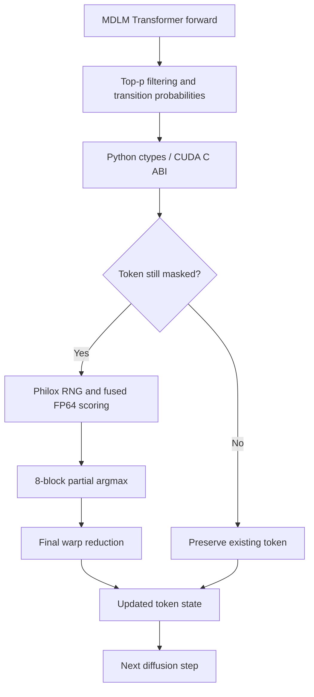

# Mask-Aware CUDA Sampling for Diffusion LLMs

A CUDA optimization experiment for masked diffusion language model inference, evaluated on NVIDIA SDLLM-MDLM-1.7B-Base and a GeForce RTX 4050 Laptop GPU (6 GB).

The project accelerates categorical sampling by eliminating redundant work at already-unmasked token positions. It combines fused FP64 sampling, multi-block parallel reduction, and mask-aware execution without changing the BF16 model weights, Transformer forward pass, or top-p filtering relative to the experimental PyTorch baseline.


## V5: Dual-Level Sparsity-Aware Sampling

The following results describe the earlier benchmark. See the extended benchmark below for newer results.

V5 extends V3 with vocabulary-level zero-probability
skipping, exploiting two levels of sparsity:

- Token-level: skip already-unmasked token positions.
- Vocabulary-level: skip zero-probability candidates
  introduced by top-p filtering.

The optimization is optional (`skip_zero=True`)
and disabled by default.

| Metric | Result |
| --- | ---: |
| Maximum end-to-end speedup vs. PyTorch | 1.231x |
| Mean end-to-end speedup vs. PyTorch | 1.179x |
| Maximum kernel speedup vs. V3 | 43.79x |
| Mean end-to-end speedup vs. V3 | 1.071x |
| Paired benchmark wins vs. V3 | 46/60 |
| Peak allocated memory reduction | ~250 MiB |
| Shared-noise token agreement | 128,448/128,448 |
| Active token agreement | 62,243/62,243 |

V5 improves five of six tested configurations.
At length 64 and 64 diffusion steps, latency
increased from 3.128s to 3.202s.

Native RNG consumption differs when zero-probability
candidates are skipped. Identical seeds therefore do
not guarantee identical generation trajectories.

Shared-noise validation passed across 960 sampling
calls. Statistical tests found no significant deviation
in the larger low-confidence retest. Downstream
generation quality equivalence remains unproven.

### V5 Experimental Results

- [Sparse kernel benchmark](results/sparse_skip.csv)
- [V5 vs. PyTorch](results/end_to_end_v5.csv)
- [Paired V3 vs. V5 benchmark](results/v3_vs_v5.csv)


## Extended End-to-End Benchmark

NVIDIA SDLLM-MDLM-1.7B-Base, RTX 4050 Laptop 6GB,
WSL2, BF16, batch size 1, 64 diffusion steps.
30 measured runs per configuration, 360 runs in total.

| Metric | Best measured result |
| --- | ---: |
| End-to-end speedup | 2.605x |
| P50 latency reduction | 61.61% |
| P95 latency reduction | 61.20% |
| Effective TPS improvement | 160.50% |
| Peak effective TPS | 37.41 |
| Peak allocated memory reduction | 490.62 MiB |

### Effective Throughput (TPS)

| Length | PyTorch | CUDA V3 | CUDA V5 |
| ---: | ---: | ---: | ---: |
| 64 | 17.73 | 21.12 | 20.01 |
| 128 | 24.09 | 28.43 | 29.60 |
| 192 | 15.20 | 33.69 | 37.41 |
| 256 | 12.94 | 33.42 | 33.71 |

### P50 Latency (seconds)

| Length | PyTorch | CUDA V3 | CUDA V5 | V5 Speedup |
| ---: | ---: | ---: | ---: | ---: |
| 64 | 3.609 | 3.030 | 3.198 | 1.129x |
| 128 | 5.314 | 4.503 | 4.324 | 1.229x |
| 192 | 12.631 | 5.699 | 5.132 | 2.461x |
| 256 | 19.782 | 7.660 | 7.594 | 2.605x |

### P95 Latency (seconds)

| Length | PyTorch | CUDA V3 | CUDA V5 |
| ---: | ---: | ---: | ---: |
| 64 | 3.943 | 3.320 | 3.649 |
| 128 | 5.491 | 4.887 | 4.603 |
| 192 | 12.901 | 5.871 | 5.274 |
| 256 | 19.931 | 7.769 | 7.733 |

### Amortized Time per Token Position (ms)

| Length | PyTorch | CUDA V3 | CUDA V5 |
| ---: | ---: | ---: | ---: |
| 64 | 56.39 | 47.35 | 49.97 |
| 128 | 41.51 | 35.18 | 33.78 |
| 192 | 65.79 | 29.68 | 26.73 |
| 256 | 77.27 | 29.92 | 29.66 |

### Peak Allocated GPU Memory (MiB)

| Length | PyTorch | CUDA V3 | CUDA V5 |
| ---: | ---: | ---: | ---: |
| 64 | 4661.38 | 4635.40 | 4635.40 |
| 128 | 5036.82 | 4786.20 | 4786.20 |
| 192 | 5413.01 | 5042.38 | 5042.38 |
| 256 | 5789.19 | 5298.57 | 5298.57 |

### V5 Incremental Improvement over V3

| Length | Median latency reduction |
| ---: | ---: |
| 64 | -5.54% |
| 128 | 3.97% |
| 192 | 9.95% |
| 256 | 0.86% |

### Methodology and Limitations

- One warmup per configuration.
- Rotating execution order across three modes.
- Fixed random seed (42) and five-token prompt.
- CUDA synchronization before and after timing.
- All 360 measured runs completed successfully.
- Effective TPS counts returned positions excluding
  the prompt; actual emitted token counts remain
  unverified.
- Amortized time per token position is not TPOT.
- TTFT was not directly measured.
- Peak reserved memory was identical across modes
  due to possible allocator reuse.
- Long-sequence speedups may include GPU memory
  residency or paging effects.
- Downstream generation quality parity remains
  unverified.

A separate single-run capacity probe completed length
384. Length 512 was interrupted after a prolonged
stall; an exact capacity limit was not established.

### Benchmark Artifacts

- [Benchmark results](results/benchmark_formal.csv)
- [Benchmark script](overlay/benchmark_extended.py)


## Results (Earlier Experiments)

| Metric | Measured result |
| --- | ---: |
| End-to-end speedup | 1.069–1.150× |
| Mean speedup across six configurations | 1.109× |
| Maximum end-to-end peak allocated memory reduction | ~250 MiB |
| Sampling speedup with 13 of 133 positions masked (V3 vs. V2) | 9.081× |
| Shared-noise token agreement | 128,448 / 128,448 (100%) |
| Shared-noise active token agreement | 62,243 / 62,243 (100%) |

## Motivation

In the tested absorbing-mask diffusion sampler, already-unmasked tokens are retained at each update. The original categorical sampler nevertheless computes random scores and argmax reductions for every token position before discarding results for fixed tokens. As generation progresses, this becomes increasingly redundant.

V3 checks the mask state before vocabulary-wide scoring. Fixed positions bypass sampling and preserve their existing token IDs. Masked positions follow the original categorical scoring rule.

## Architecture



For positive sampling temperature `T`, the reference score for vocabulary entry `i` is `p[i] / (-log(u[i]))**T`, where `u[i]` is a uniform random variate. V3 evaluates the same scoring rule and reduces to the winning token index without materializing vocabulary-sized noise or score tensors in native RNG mode.

### Optimization stages

| Version | Technique | Outcome |
| --- | --- | --- |
| V1 | Fused RNG, log, power, division and argmax | Reduced intermediate allocations |
| V2 | Multi-block parallel reduction | Improved standalone sampling throughput; no consistent end-to-end gain |
| V3 | Mask-aware early exit | Final implementation; skips scoring at fixed positions |
| V4 | Experimental active-row top-p filtering | Not selected: marginal observed gain and unresolved memory anomalies |

V3 launches eight 256-thread blocks per token for partial reduction, followed by one 32-thread block per token for final reduction. Inactive positions return early; the launch grid itself is not compacted. The native RNG uses cuRAND Philox, and the wrapper launches kernels on the current PyTorch CUDA stream.

## End-to-end benchmark

Batch size 1; ten paired measurements per configuration, alternating execution order; median latency. Peak memory refers to PyTorch allocated GPU memory, not total device usage.

| Generation length | Diffusion steps | PyTorch (s) | CUDA V3 (s) | Speedup | Peak memory: PyTorch / V3 (GiB) |
| ---: | ---: | ---: | ---: | ---: | ---: |
| 64 | 16 | 1.266 | 1.184 | 1.069× | 4.551 / 4.509 |
| 64 | 32 | 2.250 | 2.062 | 1.091× | 4.552 / 4.510 |
| 64 | 64 | 3.377 | 2.936 | 1.150× | 4.568 / 4.527 |
| 128 | 16 | 1.385 | 1.259 | 1.099× | 4.918 / 4.674 |
| 128 | 32 | 2.754 | 2.489 | 1.107× | 4.918 / 4.674 |
| 128 | 64 | 5.167 | 4.533 | 1.140× | 4.918 / 4.674 |

### Mask scaling (standalone kernel rebuild test)

Vocabulary size: 131,072. Total token positions: 133. V2 baseline: 9.004 ms.

| Remaining masked positions | V3 latency (ms) | Speedup vs. V2 | Correctness |
| ---: | ---: | ---: | --- |
| 133 | 8.825 | 1.020× | Pass |
| 99 | 6.541 | 1.377× | Pass |
| 66 | 4.419 | 2.038× | Pass |
| 33 | 2.297 | 3.920× | Pass |
| 13 | 0.992 | 9.081× | Pass |
| 0 | 0.046 | 196.766× | Pass |

The zero-mask case measures the early-exit path, not language model inference. The table uses the later repository rebuild run; the CSV retains the earlier experiment.

Raw reported results: [end-to-end CSV](results/end_to_end.csv), [mask scaling CSV](results/mask_scaling.csv).

## Correctness validation

- **Shared-noise lockstep:** five prompts, three seeds, 64 diffusion steps, 960 sampling calls. All 128,448 token states matched the PyTorch reference, including all 62,243 active positions. Both samplers received the same probabilities, mask state and FP64 noise along the same model trajectory.
- **Native RNG:** 1,048,576 draws per implementation on a synthetic eight-category distribution; chi-square p-values of 0.0786 (PyTorch) and 0.2193 (V3).
- **Real model distributions:** full 131,072-entry vocabulary, testing high-confidence, low-confidence and mask-competition cases. The initial V3 low-confidence test returned p = 0.0201; a larger retest with different seeds and 262,144 draws per implementation returned p = 0.4353 for V3 and 0.5715 for PyTorch. No zero-probability tokens were sampled in the real-distribution tests.

These results support numerical agreement under shared noise and provide statistical evidence against large sampling biases in the tested cases. They do not establish exact native-RNG sequence equivalence or downstream task quality parity. A ten-example GSM8K smoke test was inconclusive.

See [correctness results](results/correctness.md).

## Environment

| Component | Tested configuration |
| --- | --- |
| GPU | NVIDIA GeForce RTX 4050 Laptop, 6 GB, SM 8.9 |
| OS | Linux under WSL2 |
| CUDA Toolkit | 13.3 |
| Python | 3.11 |
| PyTorch | 2.9.0+cu128 |
| Model | NVIDIA SDLLM-MDLM-1.7B-Base |
| Precision | BF16 weights, FP32 transition probabilities, FP64 sampling scores/noise |
| Vocabulary | 131,072 |

## Build and run the standalone kernel test

Requires an NVIDIA GPU, a compatible driver, CUDA Toolkit (`nvcc`), Python and CUDA-enabled PyTorch. From the repository root:

```bash
./build.sh
cd overlay
python test_sampling_v3.py
```

The build defaults to `sm_89`. To target a different compatible GPU, set `CUDA_ARCH` to its compute architecture before running `build.sh`. Other architectures have not been validated here.

The standalone build and V3 mask-scaling test were successfully rerun from the packaged repository on the original machine and Python environment. A fresh-machine installation has not been validated.

## Model integration

The original experiments used a locally modified NVIDIA MDLM implementation. Model weights, upstream source files and integration patches are intentionally not distributed in this public edition.

To reproduce the model-level experiments, obtain the [upstream model release](https://huggingface.co/nvidia/SDLLM-MDLM-1.7B-Base) under its applicable terms, install its dependencies, prepare the local BF16 state-dict checkpoint, and integrate V3 at the categorical sampling stage. Preserve top-p filtering and transition probability construction. Pass the contiguous FP32 probabilities, contiguous INT64 token state, mask index, positive temperature, seed and a distinct nonce per sampling invocation to `sample_cuda_v3`. Enable the V3 path only for the supported sampler and retain the reference path for comparisons.

The model-dependent benchmark and validation scripts in `overlay/` are retained as experimental references. They require the corresponding local MDLM integration; they are not runnable from a standalone clone alone. The exact upstream revision was not recorded, and full end-to-end reproduction from a fresh environment remains unverified.

## Repository layout

```text
diffusion-llm-cuda-public/
├── README.md
├── LICENSE
├── THIRD_PARTY_NOTICES.md
├── build.sh
├── overlay/
│   ├── cuda_ops/                 # CUDA kernels and C++ binding
│   ├── cuda_sampling*.py         # ctypes wrappers
│   ├── benchmark*.py            # Performance experiments
│   ├── profile_model.py         # GPU profiling
│   ├── capture_probs.py         # Real distribution capture
│   └── test_*.py                # Correctness and sampling tests
└── results/
    ├── end_to_end.csv
    ├── mask_scaling.csv
    └── correctness.md
```

## Limitations

The optimization targets categorical sampling in the tested absorbing-mask sampler, not the entire diffusion model. Transformer computation and top-p sorting remain unchanged in V3. Results are limited to one model, one GPU, batch size one, length settings 64–256 and 16/32/64 diffusion steps. Sampling agreement under shared noise is not a proof for all inputs, and downstream quality equivalence is not established. The model-dependent scripts require manual integration as described above.

## License and acknowledgments

Original contributions are intended to be distributed under [Apache-2.0](LICENSE). Third-party software and models remain subject to their respective terms; see [THIRD_PARTY_NOTICES.md](THIRD_PARTY_NOTICES.md). This is an independent optimization experiment, not an official NVIDIA release.

Acknowledgment: NVIDIA SDLLM-MDLM-1.7B-Base, PyTorch and NVIDIA CUDA/cuRAND.
